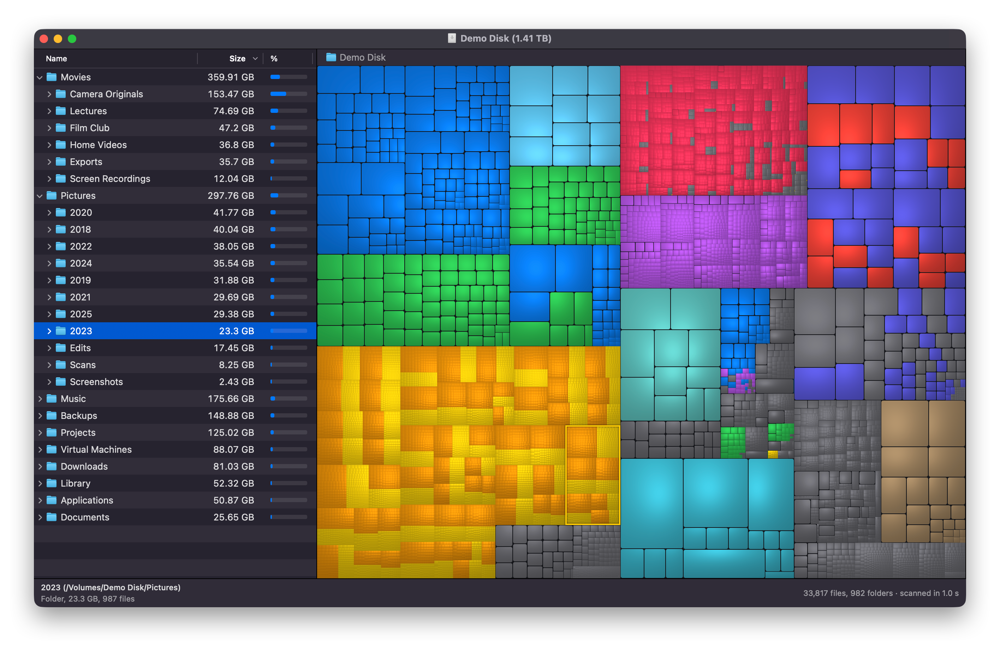

# Disk Inventory M

A disk usage viewer for macOS on Apple silicon, in the spirit of
[Disk Inventory X](https://www.derlien.com/): a list of folders with their sizes next to a
cushion treemap, where every file is a rectangle coloured by its kind.



*A demo disk of made-up files.*

The last official release of Disk Inventory X dates from 2019 and is Intel only, so it runs through
Rosetta. This is a new, native implementation, with an M for Apple's M chips. It shares no code or
artwork with the original.

Disk Inventory M is an independent project, not affiliated with or endorsed by Disk Inventory X or
its author, Tjark Derlien. If you want the original itself on Apple silicon, there is
[Disk Inventory Xs](https://github.com/diskinv/diskinv), a community port of its code.

## Building

You need macOS 15 or later and the Command Line Tools. Xcode is not required.

```sh
make run        # builds "build/Disk Inventory M.app" and opens it
make test       # unit tests
make ui-test    # the real app, driven end to end on a throwaway disk image
```

## Full Disk Access

macOS keeps some folders closed to apps. Without Full Disk Access, Disk Inventory M asks for each
protected folder as it reaches it, and shows a banner for whatever stayed closed. To see
everything, add the app under System Settings > Privacy & Security > Full Disk Access.

The app reads names and sizes only, never the contents of files, and it does not cause files
stored in iCloud to be downloaded.

The build is signed ad hoc, which macOS treats as a new app after every rebuild, so the permission
has to be granted again. Signing with a certificate of your own avoids that:

```sh
SIGN_IDENTITY="My Certificate" scripts/build-app.sh
```

## Using it

| Action | How |
| --- | --- |
| Find out what a rectangle is | Point at it; the status bar shows its name, kind and size |
| Select | Click in the treemap or the list; the two stay in step |
| Zoom in | Double-click in the treemap, or ⌘+ on the selection |
| Zoom out | ⌘−, or click a folder in the path bar |
| Select the enclosing folder | ⌘U |
| Reveal in Finder / Quick Look | ⇧⌘F / Space |
| Move to Trash | ⌘⌫ |
| Scan again | ⌘R for everything, ⇧⌘R for the selected folder |
| Show the kinds panel | ⌥⌘K |
| Highlight one kind of file | Click it in the kinds panel |
| List all files of a kind | Double-click it in the kinds panel |
| Show the list of files | ⌥⌘L |
| Find by name | ⌘F, in the list of files |
| Show the toolbar | ⌥⌘T |
| Change the map's colours | View > Map Colors |

A solid outline in the map means that rectangle is what you selected. Anything too small for that
is marked in its place instead: with a dashed outline around the small files it is among, or with a
ring if even they take up next to no room.

The keyboard shortcuts follow the original where it had them. The window starts out with just the
folders and the map: the toolbar, the kinds panel, free space and other space are all in the View
menu.

There are two sets of colours. System uses macOS's own colours, from the largest kind of file down.
With Families, a colour says what a file is, and it stays the same on every disk: blue for video,
green for images, purple for audio, orange for archives and disk images, pink for applications,
yellow for documents and slate for everything else.

## How it works

| Part | Where | Notes |
| --- | --- | --- |
| Scanner | `Sources/DiskCore/DiskScanner.swift` | Reads directories with `getattrlistbulk(2)` on all cores. Counts hard links once and stops at mount points. |
| File tree | `Sources/DiskCore/FileTree.swift` | 48 bytes per file in flat arenas, addressed by index. Nothing moves, and there is no reference counting per file. |
| Treemap layout | `Sources/DiskCore/TreemapLayout.swift` | Squarified layout (Bruls, Huizing, van Wijk). Merges anything below a pixel, so its cost follows the pixels on screen rather than the number of files. |
| Rendering | `Sources/TreemapMetal/TreemapRenderer.swift` | Cushion shading (van Wijk, van de Wetering) in a Metal fragment shader, which also rounds large tiles and sets them apart. The shader compiles at launch, so no Metal toolchain is needed to build. |
| Interface | `Sources/DiskInventoryM/` | AppKit, written in code. `NSOutlineView` copes with folders of any size. |
| `dim` | `Sources/dim/` | Command line companion: `dim scan <path>`, `dim render <path> <out.png>`. |

Treemaps are computed on a serial queue per window. The tree only changes on that same queue, and
only while the main thread waits, so nothing reads a tree halfway through a change.

## Performance

Measured on an M2 with 16 GB, with the file system cache warm:

| Measurement | Result |
| --- | --- |
| Scanning 1.09 million items on the system disk | 7 s |
| Memory for those 1.09 million items | 110 MB |
| Scanning `/opt/homebrew/Cellar` (146,000 items) | 0.33 s, against 1.03 s for `du -skx` |
| Layout of that million-item tree at 2100×1400 pixels | 11 ms |
| Drawing it, including reading the picture back | 15 ms |

Sizes match `du` to the kilobyte on every folder compared.

## Differences from Disk Inventory X

New: a Metal renderer, parallel scanning, colours by family, the share-of-folder column, Quick Look,
search by name, highlighting a kind in the treemap, and a banner explaining missing folders.

Not carried over: the Finder plugin, syncing the selection with a Finder window, the "Open With"
submenu, creator codes (which macOS stopped using long ago), and sharing colours between windows.

## License

Copyright © 2026 iV1n5

Released under version 3 of the [GNU General Public License](LICENSE). Anyone can use, study,
change and share it, as long as whatever they distribute stays under the same license, with its
source code. It comes with no warranty.
